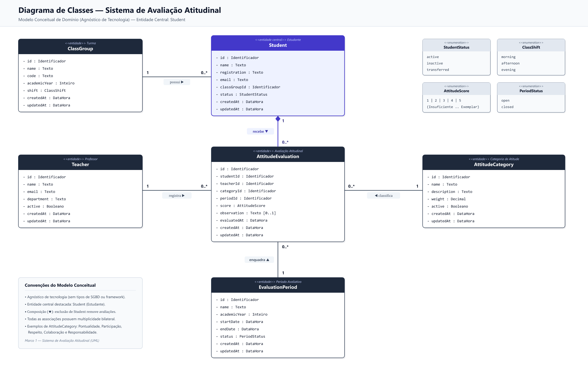
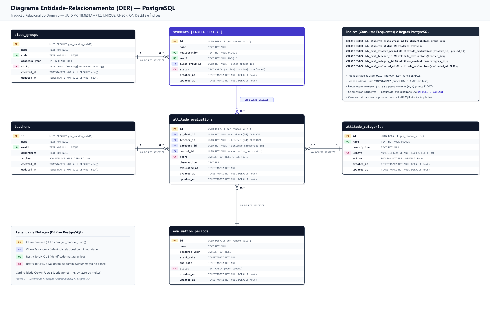

# Sistema de Avaliação Atitudinal — Marco 1

Sistema web para acompanhamento contínuo e consolidado da avaliação atitudinal de estudantes por turma, período avaliativo e dimensão comportamental (como *Pontualidade*, *Participação*, *Respeito*, *Colaboração* e *Responsabilidade*).

O escopo modelado pela equipe adota o **registro contínuo por encontro avaliativo consolidado em períodos** (bimestres/trimestres): professores atribuem pontuações em escala discreta de `1` a `5` por categoria de atitude e, opcionalmente, registram observações qualitativas, mantendo o **Estudante (`Student`)** como entidade central do domínio.

---

## Integrantes da Equipe

- Ana Caroline Pereira Aguiar
- Edson Gustavo Bezerra dos Santos
- Emilly Veronica Alves
- Roberto Ramos Ferreira

---

## Instruções de Execução

### Requisitos de ambiente

- **Node.js**: `>= 20.x` (testado com `v26.13.1`)
- **npm**: `>= 10.x` (testado com `11.20.0`)

### Passos para executar localmente

```bash
# 1. Instalar as dependências do projeto
npm install

# 2. Verificar tipagem TypeScript (sem emitir arquivos)
npx tsc --noEmit

# 3. Iniciar o servidor de desenvolvimento
npm run dev
```

Após iniciar o servidor, acesse:

- Página principal: `http://localhost:3000`
- Listagem de estudantes (Marco 1): `http://localhost:3000/lab/students`

### Como encerrar o servidor

- No terminal em que o servidor está rodando, pressione **`Ctrl + C`** (no Windows, se solicitado a confirmar *"Deseja finalizar o arquivo em lotes (S/N)?"*, digite **`S`** e pressione **`Enter`**).
- Caso a porta `3000` continue ocupada em segundo plano no Windows (PowerShell):

```powershell
Get-NetTCPConnection -LocalPort 3000 -ErrorAction SilentlyContinue | ForEach-Object { Stop-Process -Id $_.OwningProcess -Force }
```

---

## Árvore de Arquivos Produzidos

```text
├── public/
│   ├── uml.png                                # Artefato 1: Diagrama de Classes UML (agnóstico de tecnologia)
│   └── der.png                                # Artefato 2: Diagrama Entidade-Relacionamento (PostgreSQL)
├── src/
│   ├── types/
│   │   └── domain.ts                          # Artefato 3: Tipos de domínio, uniões literais e ActionResult<T>
│   ├── lib/
│   │   └── data/
│   │       ├── students.ts                    # Artefato 4: Conjunto imutável (readonly) de 15 estudantes fictícios
│   │       └── index.ts                       # Artefato 5: Consultas assíncronas (listStudents, getStudent) com latência simulada
│   ├── components/
│   │   └── students/
│   │       └── student-card.tsx               # Artefato 6: Componente de apresentação StudentCard (semântico e acessível)
│   └── app/
│       ├── layout.tsx                         # Layout raiz da aplicação Next.js
│       ├── globals.css                        # Estilos globais com Tailwind CSS
│       ├── page.tsx                           # Página inicial com atalho para a listagem de estudantes
│       └── lab/
│           └── students/
│               └── page.tsx                   # Artefato 7: StudentsPage com estados de carregamento, erro, vazio e sucesso
└── README.md                                  # Documentação operacional e justificativas de modelagem
```

---

## Decisões de Modelagem por Artefato

### Artefato 1 — Diagrama de Classes (UML)



- **Agnóstico de tecnologia**: os atributos usam tipos conceituais (`Identificador`, `Texto`, `Inteiro`, `Decimal`, `Booleano`, `DataHora`) e enumerações de domínio, sem mencionar PostgreSQL, Next.js ou TypeScript.
- **Entidade central `Student`**: concentra os atributos essenciais de identificação (`name`, `registration`, `email`, `classGroupId`, `status`) e timestamps de auditoria (`createdAt`, `updatedAt`).
- **Entidades de apoio à avaliação**:
  - `ClassGroup` organiza os estudantes em turmas (`1` para `0..*`, pois uma turma pode iniciar sem alunos matriculados e cada estudante pertence a uma turma).
  - `Teacher`, `AttitudeCategory` e `EvaluationPeriod` contextualizam quem avaliou, qual dimensão foi avaliada e em qual período letivo ocorreu o registro.
  - `AttitudeEvaluation` materializa o encontro avaliativo com composição a partir de `Student` (`1` para `0..*`): avaliações não existem de forma independente sem o estudante.
  - O atributo `observation` é opcional (`[0..1]`) porque nem todo registro rotineiro exige comentário qualitativo.

### Artefato 2 — Diagrama Entidade-Relacionamento (DER — PostgreSQL)



- **Chaves primárias UUID**: todas as tabelas utilizam `id UUID PRIMARY KEY DEFAULT gen_random_uuid()` (em vez de `SERIAL`) para evitar enumeração sequencial e manter identificadores seguros em URLs.
- **Timestamps com fuso horário**: todas as tabelas possuem `created_at TIMESTAMPTZ NOT NULL DEFAULT now()` e `updated_at TIMESTAMPTZ NOT NULL DEFAULT now()`, evitando ambiguidades de `TIMESTAMP` sem fuso.
- **Precisão numérica**: `score` usa `INTEGER CHECK (score BETWEEN 1 AND 5)` e `weight` usa `NUMERIC(4,2) CHECK (weight > 0)`, evitando erros de precisão de ponto flutuante (`FLOAT`).
- **Integridade referencial e restrições**:
  - `UNIQUE` nos identificadores naturais (`students.registration`, `students.email`, `class_groups.code`, `teachers.email`, `attitude_categories.name`).
  - `CHECK` para todas as enumerações (`status`, `shift`, `score`).
  - `ON DELETE CASCADE` na chave estrangeira `attitude_evaluations.student_id` (refletindo a composição do UML) e `ON DELETE RESTRICT` nas referências de catálogo/contexto para impedir exclusões acidentais com histórico vinculado.
- **Índices em consultas frequentes**: índices explícitos em `students(class_group_id)`, `students(status)`, `attitude_evaluations(student_id, period_id)`, `attitude_evaluations(teacher_id)`, `attitude_evaluations(category_id)` e `attitude_evaluations(evaluated_at DESC)`.

### Artefato 3 — Tipos em `src/types/domain.ts`

- **`type` como padrão**: todas as entidades do UML (`ClassGroup`, `Student`, `Teacher`, `EvaluationPeriod`, `AttitudeCategory`, `AttitudeEvaluation`) possuem correspondência direta 1:1 com tipos TypeScript.
- **Uniões de literais**: `StudentStatus`, `AttitudeScore`, `ClassShift` e `PeriodStatus` são modelados como uniões de literais (sem `enum`), garantindo zero sobrecarga em runtime e melhor narrowing.
- **Transporte seguro de datas**: timestamps são tipados como `IsoTimestamp` (`string` ISO 8601 com sufixo `Z`).
- **Contrato `ActionResult<T>`**: já exportado como união discriminada (`{ ok: true; data: T } | { ok: false; error: string }`) para padronizar o tratamento de erro nas futuras Server Actions.
- **Zero `any`**: tipagem estrita validada com `npx tsc --noEmit`.

### Artefato 4 — Camada Mock com Dados (`src/lib/data/students.ts`)

- Exporta `MOCK_STUDENTS` como `readonly Student[]` para impedir mutações diretas.
- Contém **15 estudantes fictícios** (nomes, matrículas e e-mails fictícios em conformidade com a LGPD), cobrindo os três estados possíveis de `StudentStatus` (`11` `active`, `2` `inactive` e `2` `transferred`).
- Todos os `id` e `classGroupId` são UUIDs válidos e todas as datas seguem ISO 8601 UTC (`Z`), em coerência exata com `src/types/domain.ts`.

### Artefato 5 — Camada Mock com Consultas e Latência (`src/lib/data/index.ts`)

- Implementa `listStudents(): Promise<Student[]>` e `getStudent(id: string): Promise<Student | null>`.
- Ambas são `async` com latência simulada de **700 ms** (dentro da faixa de 500–1000 ms), garantindo que o estado de carregamento seja exercitado na interface.
- Retornam sempre **cópias** dos objetos/array (nunca referências diretas a `MOCK_STUDENTS`), e `getStudent` retorna `null` quando o ID não é encontrado.

### Artefato 6 — Componente `StudentCard` (`src/components/students/student-card.tsx`)

- Componente puramente de apresentação (`"use client"`), com props tipadas via `type StudentCardProps`.
- Utiliza HTML semântico (`<article>`, `<header>`, `<dl>`, `<dt>`, `<dd>`) e acessibilidade (`aria-label` no elemento raiz, no ícone e no badge de status; `aria-hidden="true"` nos ícones decorativos).
- Exibe nome, matrícula, e-mail e status legível em português (`Ativo`, `Inativo`, `Transferido`).
- Não chama `useEffect`, `useState`, nem consultas de dados; qualquer interação (`onSelect`) só existe se recebida via props.

### Artefato 7 — Página `StudentsPage` (`src/app/lab/students/page.tsx`)

- Carrega os estudantes via `listStudents()` em `useEffect` com flag `cancelled` no cleanup, evitando atualização de estado após desmontagem.
- Implementa explicitamente os **quatro estados de UX**: carregamento (`role="status"`), erro (`role="alert"`), vazio (`role="status"`) e sucesso (lista com `key={student.id}`).
- Não armazena estado derivado em `useState`: os contadores de resumo (Total, Ativos, Inativos, Transferidos) são calculados diretamente a partir de `students` durante a renderização.

---

## Observações e Limitações Conhecidas

- **Escopo coberto neste marco**: modelagem conceitual (UML), modelagem relacional (DER), tipos TypeScript do domínio, camada mock com latência simulada, componente `StudentCard` e página de listagem `/lab/students`.
- **Fica para etapas seguintes**:
  - Migração da página para Server Component com App Router e busca direta no banco.
  - Criação das tabelas, políticas de RLS e integração real com PostgreSQL/Supabase.
  - Autenticação de professores/coordenação e autorização por perfil.
  - Server Actions com validação Zod retornando `ActionResult<T>` para criação/edição de estudantes e registro de avaliações atitudinais.
  - Telas dedicadas de turmas, períodos, categorias e lançamento/relatórios de avaliações.
